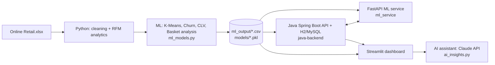

# Retail Intelligence Dashboard

An integrated analytics project that combines **Python, Machine Learning, AI, Data Analytics and Java**
on the UCI *Online Retail* dataset (541,909 transactions, 4,338 customers).

## Architecture



| Technology | Where it is used |
|---|---|
| Data Analytics | `streamlit_app.py`, `pages/Customer_RFM.py`, RFM scoring and segments |
| Python | Data cleaning, dashboard, ML pipeline, FastAPI service |
| Machine Learning | `ml_models.py`: K-Means clusters, churn classifier, CLV regressor, association rules |
| AI | `ai_insights.py`, `pages/AI_Assistant.py`: natural-language Q&A and campaign generator (Claude API) |
| Java | `java-backend/`: Spring Boot REST API, JPA database, ETL loader, calls the Python ML service |

## Machine learning (summary)

- **Clustering:** K-Means on log-scaled Recency/Frequency/Monetary; *k* chosen by silhouette score.
- **Churn:** Gradient Boosting predicts "no purchase in the next 90 days". Trained on a snapshot taken
  90 days before the end of the data, so there is no data leakage. ROC-AUC ~0.70 (recency-only baseline ~0.66).
- **CLV:** Gradient Boosting regression on log revenue predicts spend over the next 90 days.
- **Basket analysis:** support / confidence / lift for the 200 best-selling products.

## Run it

### 1. Python setup
```bash
python -m venv venv
venv\Scripts\activate          # Windows   (Mac/Linux: source venv/bin/activate)
pip install -r requirements.txt
```

### 2. Train the models (creates `ml_output/` and `models/`)
```bash
python ml_models.py
```

### 3. Start the dashboard
```bash
streamlit run streamlit_app.py
```
Pages: Business Overview, Customer RFM, **ML Insights**, **AI Assistant**.

### 4. (Optional) AI answers with Claude
```bash
set ANTHROPIC_API_KEY=your_key      # Windows CMD  (PowerShell: $env:ANTHROPIC_API_KEY="your_key")
```
Without a key the assistant still works in offline, rule-based mode.

### 5. (Optional) Python ML service + Java API
Terminal A (project root):
```bash
uvicorn ml_service.main:app --port 8000
```
Terminal B:
```bash
cd java-backend
mvn spring-boot:run
```
Requires Java 17+ and Maven. Check: http://localhost:8080/api/health

| Endpoint | Description |
|---|---|
| `GET /api/customers?segment=&risk=&limit=` | Filtered customer list |
| `GET /api/customers/{id}` | One customer with churn probability and predicted CLV |
| `GET /api/segments` | Aggregates per segment |
| `GET /api/at-risk?limit=20` | Highest-spending customers likely to churn |
| `GET /api/ml/health`, `GET /api/customers/{id}/ml` | Proxied from the Python service |

When the Java API is running, the Streamlit pages read their data from it automatically
(shown in the sidebar); otherwise they use the CSV file. Set `JAVA_API_URL` to change the address.
To use MySQL instead of H2, see `java-backend/src/main/resources/application-mysql.properties`.

## Project structure
```
streamlit_app.py        Business overview page
pages/                  Customer_RFM.py, ML_Insights.py, AI_Assistant.py
data_utils.py           Loading and cleaning
ml_models.py            Training pipeline
ai_insights.py          AI layer
api_client.py           Java API / CSV loader
ml_service/main.py      FastAPI service
java-backend/           Spring Boot API
ml_output/, models/     Generated by ml_models.py
```

## Quick start on Windows
Double-click `run.bat` (needs Python 3.11 or 3.12). If anything fails, run `python check_setup.py` inside the activated venv.
